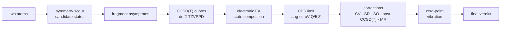

# OpenEA

**Two atoms in, electron affinity out.**

OpenEA computes the adiabatic electron affinity EA₀ of a diatomic molecule from nothing but
its two element symbols. It finds the electronic states of the neutral molecule and the
anion, decides which methods and corrections are needed, runs them, and returns an
interval with a status, or `UNBOUND` if the anion is not bound. There are no manual choices
and no reference data: experimental values are used only afterwards, to check the result.

```bash
python -m openea_benchmark.workflow --atoms O H --output results/OH
```

```json
{"outcome": "EA", "ea_ev": 1.8284, "ea_lower_ev": 1.8057, "ea_upper_ev": 1.8511,
 "scope": "adiabatic EA_0, lowest spin-orbit levels, main isotopologue"}
```

Everything runs on open-source quantum chemistry: [PySCF](https://pyscf.org),
[CCpy](https://github.com/piecuch-group/ccpy) (CCSDT, CCSDT(Q)) and
[OpenMolcas](https://gitlab.com/Molcas/OpenMolcas) (spin–orbit, multistate CASPT2).

## Results

Reference set, each molecule run fully automatically from its two atoms with the same
settings:

| Molecule | Regime | EA₀ OpenEA (eV) | Experiment (eV) | Δ (eV) |
|---|---|---|---|---|
| OH  | closed-shell anion | 1.828 (1.806–1.851) | 1.828 | 0.000 |
| CN  | | 3.861 (3.850–3.872) | 3.862 | −0.001 |
| NO  | very small EA | 0.022 (0.010–0.034) | 0.026 | −0.004 |
| O₂  | open-shell anion | 0.444 (0.430–0.459) | 0.448 | −0.004 |
| ClO | second row | 2.279 (2.260–2.299) | 2.276 | +0.003 |
| AlO | two ROHF branches | 2.613 (2.539–2.688) | 2.60 | +0.01 |
| SiC | | 2.374 (2.352–2.396) | 2.396 | −0.022 |
| C₂  | strong multireference | 3.286 (3.267–3.306) | 3.269 | +0.017 |
| MgH | | 0.877 (0.872–0.881) | 0.90 ± 0.05 | −0.02 |
| LiH | diffuse anion | 0.334 (0.331–0.337) | 0.342 ± 0.012 | −0.008 |
| N₂  | unbound anion | `UNBOUND` | unbound | ✓ |

Transition-metal and heavy-element molecules (3d, 4d/5d with pseudopotentials,
lanthanides) are the next validation step.

## How it works



| # | Layer | What it decides | Module |
|---|-------|-----------------|--------|
| 1 | Symmetry scout | Candidate states of neutral and anion (Wigner–Witmer rules, atomic terms, DFT scans per symmetry block) | `symmetry_scout`, `state_candidates`, `symmetry_states` |
| 2 | Fragment asymptotes | Dissociation limits; states too high above them are dropped | `open_pec_extension` |
| 3 | Stage-3 curves | CCSD(T)/def2-TZVPPD potential curves with identity, continuity and stability checks | `adaptive/stage3_*`, `benchmark_auto` |
| 4 | Reference branches | A curve that jumps between two ROHF solutions is split; the offset becomes an uncertainty | `reference_branches` |
| 5 | Electronic EA | Minima, ground state of each charge, anion binding against its fragments | `electronic_ea_stage` |
| 6 | CBS limit | Frozen-core CCSD(T) in aug-cc-pV{Q,5}Z plus a d-aug diffuse check; competitors re-ranked at CBS | `cbs_stage` |
| 7 | Core-valence | All-electron minus frozen-core CCSD(T) | `core_valence_stage` |
| 8 | Scalar relativity | Spin-free X2C minus non-relativistic CCSD(T) | `scalar_relativity_stage` |
| 9 | Spin–orbit | First order (CASSCF/AMFI); beyond Kr multistate SO-XMS-CASPT2 | `spin_orbit_stage`, `spin_orbit_multistate` |
| 10 | Post-CCSD(T) | CCSDT and CCSDT(Q) increments | `post_ccsd_t_stage` |
| 11 | Multireference | SA-CASSCF/NEVPT2 for states CCSD(T) cannot describe | `mr_competitors`, `mr_term_gap`, `mr_nuclear_curve` |
| 12 | Zero-point vibration | Vibrational levels on the curves: EA₀ = EA_e + ΔZPE | `vibrational_stage` |
| 13 | Final verdict | `EA` with interval, `UNBOUND`, or `UNRESOLVED` with the blocking reason | `final_resolver` |

**Principles**

- **Fail closed.** A layer that cannot prove its part reports a status (`UNRESOLVED`,
  `NEED_MORE_EVIDENCE_*`) instead of a number, and the final verdict names it.
- **No reference data.** No experimental EAs, term energies or bond lengths enter the
  calculation; atomic states come from aufbau rules and computed energies.
- **No per-molecule tuning.** Every rule is general; a problem found on one molecule
  becomes a rule for all.
- **Uncertainty from evidence.** Interval widths come from the computed sensitivities
  (CBS model spread, reference branches, correction bounds), not from a fixed error bar.

## Elements

| Route | Elements | Hamiltonian and basis |
|---|---|---|
| All-electron | H – Kr | non-relativistic, Dunning aug-cc-pVXZ; relativity as corrections |
| Pseudopotential | Y – Xe, Hf – Rn | cc-pVXZ-PP with small-core ECP |
| All-electron X2C | Rb, Sr, Cs, Ba, La – Lu, Fr – Lr | spin-free X2C, cc-pVXZ-X2C |
| Not supported | Z > 103 | stops with `ELEMENT_NOT_SUPPORTED` |

Atoms with an open d or f shell in the neutral atom or the anion get two extra fragment
layers: every low configuration is targeted and correlated (CCSD(T) on each), and a
multistate SO-XMS-CASPT2 calculation gives the lowest spin–orbit level.

## Output

Per molecule `results/AB/benchmark_auto/`:

| File | Content |
|---|---|
| `auto_state.json` | full record; `final_verdict` is the result |
| `adiabatic_ea.json` | EA₀ assembly: every correction with its bound |
| `electronic_ea/`, `cbs/`, `core_valence/`, `scalar_relativity/`, `spin_orbit/`, `post_ccsd_t/`, `mr_competitors/`, `nuclear_motion/` | one record per layer |
| `points/`, `checkpoints/` | cached calculations; a rerun resumes from them |

## Installation

```bash
python -m venv .venv
.venv/bin/pip install -e .[dev]
.venv/bin/pytest                      # unit tests, no quantum-chemistry jobs
```

Python ≥ 3.11, PySCF 2.14. Optional but needed for heavier systems:

- **CCpy** for post-CCSD(T) (importable as `ccpy`),
- **OpenMolcas** for spin–orbit and multistate layers: set `OPENEA_MOLCAS` to the install
  directory containing `pymolcas` (default: `external/openmolcas-install-v26.06-serial-ilp64`).

## Running many molecules

```bash
scripts/start_detached.sh verify_v1 O:H Ti:O Ag:Ag
```

starts a detached batch: logs in `runs/verify_v1/<AB>.log`, results in
`../openea_results/verify_v1/<AB>/` (`OPENEA_OUTPUT` changes the root). All runs on the
machine share a core-slot budget and a memory gate (a calculation starts only while used
plus reserved memory stays below 70 % of RAM); a watchdog pauses at 70 % and stops at 80 %.
`THREADS`, `CORE_SLOTS`, `CBS_MEMORY_MB` and `MEM_LIMIT_FRAC` are environment overrides.
Stop a batch with `kill -TERM -- -<pid>` (the pid is printed and stored in `runs/<run>/`).

## Known limitations

- **Heavy elements are not yet validated end to end.** The routes exist for every element
  up to Lr; the first 3d (TiO) and 4d (Ag₂) molecules were interrupted before the final
  verdict.
- **Configuration targeting of d/f atoms in large bases.** In aug-cc-pVQZ the La⁻ 5d²6s²
  configuration is not yet reached (aug-cc-pVTZ works: La atomic EA 0.45 eV vs 0.56 eV).
- **Open 4f/5f shells.** The atomic multistate layer becomes too expensive for atoms like
  Gd or U (full 4f/5d/6s/6p active space); a smaller or selected-CI space is needed.
- **Cost.** A light diatomic takes one to a few hours on one 80-core node; a molecule with 4d or 5d
  atoms takes one to several days (5Z coupled cluster, multistate spin–orbit).

## Repository

```
src/openea_benchmark/
  workflow.py            entry point
  *_stage.py             one module per layer (table above)
  adaptive/              Stage-3 execution, identity checks, nuclear motion
  attachment/            atomic fragments, CBS extrapolation, EA assembly
scripts/                 batch launch, memory watchdog, validation scripts
docs/                    design notes per layer (index: docs/README.md)
tests/                   unit tests
```

Calculation output and caches are never committed. The repository state before the
October 2026 cleanup (old DFT-scout pipeline, evidence-planning layers, FeH pilots) is
kept in the tag `archive/pre-cleanup-2026-10-16`. See `CONTRIBUTING.md` for development rules.

## Background

OpenEA grew out of the need for electron affinities in laser photodetachment for accelerator mass
spectrometry, where most diatomic anions have never been measured. Its predecessors:

- [DiatomicEA](https://github.com/Paranoidgrinch/diatomic-ea) — a released desktop app that estimates EAs
  from a fixed DFT ensemble with calibrated prediction intervals. Fast, but limited by DFT.
- [diatomic-ea-workflow](https://github.com/Paranoidgrinch/diatomic-ea-workflow) (v0.9) — explicit discovery
  and following of electronic states along the potential curve; its ideas became OpenEA's state layers.

## License

GPL-3.0-only — see [LICENSE](LICENSE).
